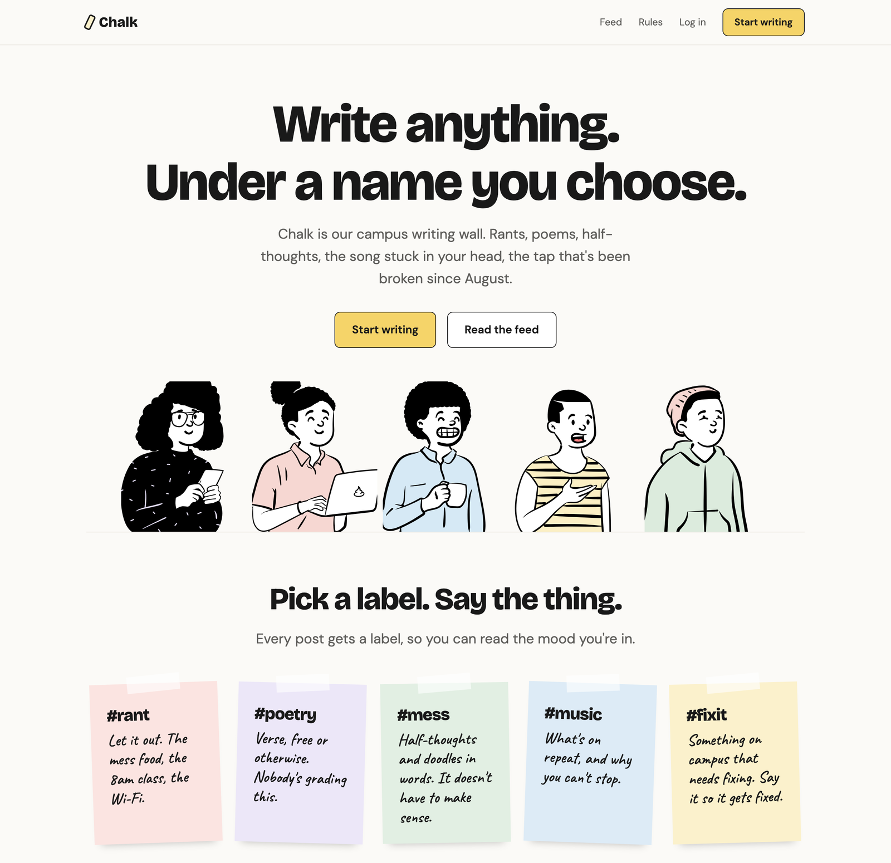

# Chalk

**A campus writing space.** Write about anything (a rant, a poem, a half-finished thought, the song stuck in your head, the tap that's been broken since August) under a name you choose.

Chalk is built by the students of the open source guild. It's small on purpose, so it can be your **first real open source contribution**.



---

## What Chalk will do

- **A shared campus feed:** everyone's posts in one place, newest first.
- **Labels on every post:**

  | Label | For |
  |---|---|
  | `#rant` | Letting it out |
  | `#poetry` | Verse, free or otherwise |
  | `#mess` | Half-thoughts and doodles in words |
  | `#music` | What's on repeat, and why |
  | `#fixit` | Something on campus that needs fixing |

- **Your own page:** a personal page you can dress up with a theme. Each theme is one CSS file, and anyone can add a new one.
- **Text and images** to start. Audio and video links come later(scoped for future).

### How names work

- You log in with your college account, so everyone on Chalk is from campus.
- You post under a **handle** you choose. Other students only ever see the handle.
- **Moderators can see which account is behind a handle**, and only look in serious cases. This is stated openly in the community rules.
- It's a nickname, not a mask. On a small campus, people may still recognise how you write.

### Community rules (short version)

- No negative posts about named people.
- Don't share photos of others without their consent.

---

## Where the project is right now

Chalk is being built step by step, in the open.

| Part | Status |
|---|---|
| Landing page (design, HTML, CSS, illustrations) | In progress |
| Feed, posting, labels |  Next |
| Login and handles | Planned |
| Personal pages and themes |  Planned |
| Backend API, database, tests | Planned |

Many features are deliberately left unbuilt so they can become starter issues for new contributors.
Open to ideas as a separate discussion forum

---

## Run it locally

Right now Chalk is a plain HTML and CSS page, so there's nothing to install.

1. Install [Git](https://git-scm.com/downloads).
2. Get the code:

   ```bash
   git clone https://github.com/BeNikk/Chalk.git
   cd Chalk
   ```

3. Open `client/index.html` in your browser (use live server extension preferably).

After you change a file, save it and refresh the browser to see the change.

> When the backend arrives, these steps will change to a single setup command. This section will be updated then.

---

## How the code is organised

```
client/                  the website (plain HTML, CSS and JavaScript)
  index.html             the landing page
  css/
    base.css             colors, fonts and spacing as CSS variables, plus basic text styles
    layout.css           where things go: header, sections, grids, footer
    components.css       how single pieces look: buttons, cards, sticky notes
  illustrations/         the drawings of people used across the site
server/                  the backend API (coming soon)
docs/                    contributing guide and pull request template
  images/                screenshots used in the docs
```

### Design in one paragraph

Calm and clean, like a notebook: an off-white background, near-black text, big bold headings, thin borders and lots of space. Color comes from soft pastel tints (one per label) and the yellow main button. Hand-drawn people from [Open Peeps](https://www.openpeeps.com/) appear around the page and wobble when you hover over them. The quirky stuff goes on personal pages, through themes.

### Tech

- **Frontend:** plain HTML, CSS and JavaScript. No frameworks and no build step, so you can read every file.
- **Backend (planned):** Node.js with Express, a PostgreSQL database, and Google login limited to college accounts.
- **Fonts:** [Bricolage Grotesque](https://fonts.google.com/specimen/Bricolage+Grotesque) for headings, [DM Sans](https://fonts.google.com/specimen/DM+Sans) for text, [Caveat](https://fonts.google.com/specimen/Caveat) for handwriting.

---

## Contributing

New to open source? Good, this project is for you.

Read the **[contributing guide](docs/CONTRIBUTING.md)**. It walks you through setting up, picking an issue, making a change you understand, and opening your first pull request.

Good places to start:

- Issues labelled [`first-timer`](https://github.com/BeNikk/Chalk/labels/first-timer) or [`good-first-issue`](https://github.com/BeNikk/Chalk/labels/good-first-issue)
- Adding your own drawing (see [`client/illustrations/README.md`](client/illustrations/README.md))

---

## Credits

- Illustrations: [Open Peeps](https://www.openpeeps.com/) by Pablo Stanley, released under CC0.
- Built by the students of our open source guild.
